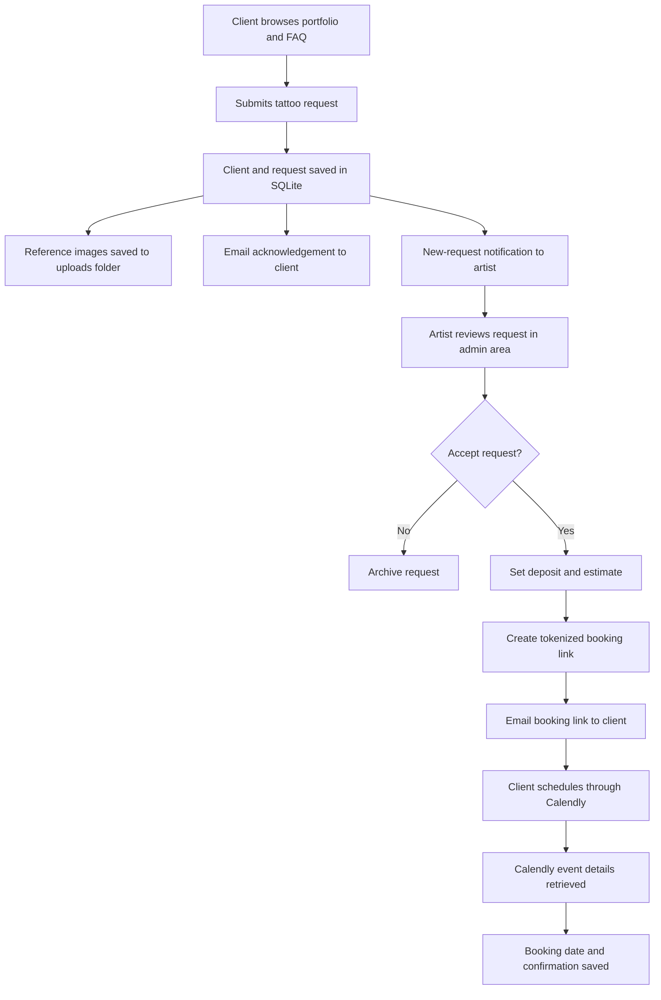

# Capricorn Pokes

A Flask-based tattoo booking platform & portfolio website for independent tattoo artists. Made specifically for my wife, you're able to browse her currently available flash, submit a booking request, and visit her shop. It also features an admin side, that allows her to be able to view all requests, all booked requests, as well as send out her own booking forms for clients that she meets in person/through another platform.

While all features were built with her in mind, this is easily customizable to fit your own preferences and needs. If you're tech savvy, read through the rest below to configure to your own needs. If you'd like some help getting set up-don't hesitate to reach out :)

### Why Did I Make This?

Instagram has been a major platform for finding and booking tattoos for the last 10 years. For most this works, but for others that want to decentralize their data (and more specifically move away from Meta maintained apps) this is an option to store your client data locally, and have an Instagram-like portfolio page.

## Features

### Public Site

 - Landing page, tattoo portfolio, and FAQ page.
 - Tattoo request form for both flash and custom ideas.
 - Client contact details and tattoo preferences, including size, placement, and budget.
 - One or two uploaded reference images per request.
 - Email acknowledgement to the client and a new-request notification to the artist.

### Admin Tools

 - Password-protected admin area.
 - View current, unbooked requests, and upcoming bookings.
 - Search requests and bookings using selected fields.
 - Archive requests that are not moving forward.
 - Review a request and prepare a booking offer with a deposit amount and estimate.
 - Create bookings manually whenever needed.

### Booking and Scheduling

 - Generate a unique, tokenized booking link for all approved requests.
 - Send the booking link to the client by email- automatically done upon acceptance of a request
 - Calendly used for appointment scheduling/Google Calendar integration
 - All decisions made by the client through Calendly are updated in real time via Calendly API and are stored locally through SQLite.

## Technology

| Component | Technology | Role |
|---|---|---|
| Backend | Python, Flask | Routes, request handling, application configuration |
| Application structure | Flask application factory and blueprints | Separates public pages, requests, and admin functionality |
| Database | SQLite | Stores admin users, clients, tattoo requests, and bookings |
| Database access | Python `sqlite3` | Parameterized queries and connection lifecycle |
| Templates | Jinja2 | Server-rendered HTML pages |
| Styling | CSS | Site and admin interface styling |
| File uploads | Werkzeug | Sanitizes uploaded filenames; UUIDs make stored names unique |
| Email | Yagmail | Sends request and booking emails |
| Scheduling | Calendly API | Retrieves event details after a client schedules |
| Configuration | python-dotenv | Loads the Flask secret key from environment configuration |

## How the booking workflow works



## Application structure

```text
cap_pokes/
├── cpokes/
│   ├── __init__.py          # Flask application factory and blueprint registration
│   ├── admin.py             # Authentication, admin views, booking workflow, Calendly update
│   ├── db.py                # SQLite connection handling and init-db command
│   ├── email_funcs.py       # Client and artist email notifications
│   ├── landing.py           # Landing page, portfolio, and FAQ routes
│   ├── requests.py          # Public tattoo request submission
│   ├── schema.sql           # SQLite table definitions
│   ├── requirements.txt     # Python dependencies
│   ├── static/              # CSS, fonts, and portfolio assets
│   └── templates/           # Jinja2 templates
├── instance/                # Runtime database and uploaded files (not committed)
├── .env                     # Local environment variables (not committed)
└── README.md
```

### Database model

The SQLite schema defines four tables:

- `user`: admin login credentials; passwords are stored as Werkzeug password hashes.
- `client`: client contact information, keyed by `uid`.
- `requests`: tattoo request details and reference-image paths, associated with a client through `uid`.
- `bookings`: booking offer and appointment details, associated with a client through `uid` and a request through `rid`.

The current schema is defined in `cpokes/schema.sql`.

## Run locally

### Requirements

- Python installed locally.
- `pip`.
- Credentials/configuration for the email accounts and Calendly integration if you want to use those integrations.

### 1. Clone the repository

```bash
git clone https://github.com/mr-pointing/cap_pokes.git
cd cap_pokes
```

### 2. Create and activate a virtual environment

```bash
python -m venv .venv
source .venv/bin/activate       # Linux / macOS
# .venv\Scripts\activate      # Windows PowerShell
```

### 3. Install dependencies

The dependency file is currently located inside the application package:

```bash
pip install -r cpokes/requirements.txt
```


### 4. Configure local secrets

Create a `.env` file in the repository root:

```dotenv
SECRET_KEY=replace-with-a-long-random-secret
```

All artist info should be within `cpokes/artist_info.json` for artist email settings, the admin's initial password, and Calendly API configuration. This file is intentionally excluded from version control. Create it locally with the required keys:

```json
{
  "artist_name": "your-artist-name",
  "artist_email": "artist@example.com",
  "email_for_artist": "notification-account@example.com",
  "yag_pw": "email-app-password",
  "efa_pw": "notification-account-app-password",
  "admin_pw": "choose-an-initial-admin-password",
  "calendly_user": "https://api.calendly.com/users/YOUR_USER_ID",
  "calendly_api_token": "YOUR_CALENDLY_API_TOKEN"
}
```

Use credentials created for this application; do not reuse credentials that have been exposed or committed elsewhere. Keep `.env` and `artist_info.json` out of Git.

### 5. Initialize the database

```bash
flask --app cpokes init-db
```

**Warning:** `cpokes/schema.sql` starts by dropping the existing tables. Running `init-db` against an existing database destroys its current records. Use it only for a fresh local database or after making a backup when a reset is intentional.

The initialization command creates the tables and inserts the initial `admin` account using the `admin_pw` value in `artist_info.json`.

### 6. Start Flask

```bash
flask --app cpokes run
```

Open `http://127.0.0.1:5000` in a browser. The public site is served at `/`; the admin login is at `/admin`.

## Configuration and operational notes

- The Flask database is stored at `instance/clients.sqlite`.
- Uploaded request images are stored under `instance/uploads/` and referenced by path in the request records.
- The upload size limit configured by the application is 16 MB per request.
- Email and Calendly integrations require valid external credentials and network access.
- The admin authorization decorator currently checks for `session["user_id"] == 1`; the initial admin row is created during database initialization.
- The Calendly update route is `/admin/update-schedule` and expects JSON containing `event_uri` and `booking_id`.

## Future work

Possible next steps include adding automated tests, improving mobile layouts, replacing or supplementing Calendly with a first-party calendar, and strengthening all configuration and deployment documentation.

## Author

Richard Pointing  
[GitHub](https://github.com/mr-pointing) · [Personal website](https://mrpointing.com)

## License

The original project README identifies the MIT License as the intended license. A `LICENSE` file was not included in the supplied archive; add the full MIT license text to a `LICENSE` file before presenting the repository as formally licensed.
